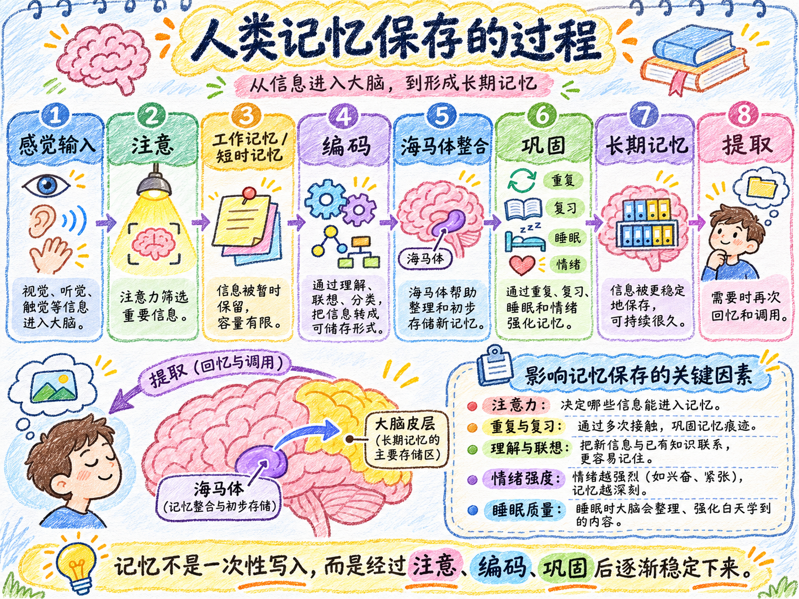

# Memory 记忆管理

## Memory 是什么
我们从人类记忆入手, 在我们学习 知识时 这段知识进入大脑并不意味着你 在下次使用时可以马上想起来, 这是因为人类记忆需要经过 几个步骤 编码, 保持, 巩固 和 提取的过程 记忆会因为线索不足无法和其他知识产生关联 从而没有被有效编码而被丢弃, 被丢弃千是存储在 工作记忆(WorkMemory) 中 你可以理解为缓存


### 人类 记忆分层
1. 工作记忆/短期记忆: 这是临时记忆缓存 并没有进入大脑的 长期记忆中
比如你在计算 `(12 + 8) * 10` 你会先计算括号内为 20 这时候你只需要暂时记住 20 在乘法运算 这种短时间保持并处理信息的能力 都属于 工作记忆范畴

2. 语义记忆(Semantic Memory): 根据 事务 的特性来记忆
比如你在学习 Memory 你就会大概知道 Memory 主要就是用于 提供历史信息 而获取 LLM 更加高质量回答的解决方案

3. 情景记忆(Episodic Memory): 这是包含 背景,事件,行动和结果的经历
通过我们经历过程与结果 来记忆

4. 程序性记忆/肌肉记忆(Procedural Memory): 人类通常反复练习从而熟练的技能 比如 开车 或者执行某些特定动作
认知科学将肌肉记忆 归入非陈述性记忆

5. 长期记忆: 记忆被印证对我们人类生存是有用的 会放入人类长期记忆中

### 人类记忆机制
人类记忆机制中有几个机制我们是可以借鉴 运用到 AIAgent 开发中
1. 不是所有信息都具有 **长期价值**
2. 记得越多 不等于 回忆越清楚 因为 噪声/干扰项 变多了(信息冲突/Token 消耗等等)
3. 线索提取非常重要
4. 记忆关联是学习的关键

### 记忆工作效仿
1. 获取: 接收用户信息/文档/工具调用等
2. 筛选: 区分暂时性记忆 和 长期记忆
3. 编码
5. 存储
6. 检索
7. 更新
8. 遗忘

Memory 就是记忆 和 人类相同, 传统 LLM 模型调用是无状态的, 例如下例
```ts
const response = await model.invoke([
  {
    role: 'user',
    content: '请你介绍一下 Memory',
  },
])

// 第二次调用
const response = await model.invoke([
  {
    role: 'user',
    content: '请你把刚刚介绍的 Memory 总结一下',
  },
])
```

通过我们两轮模型调用 它们之间是无状态的, 因为第二轮调用时没有带上 历史信息 所以 就会出现 模型可以处理当前事情 但无法得知之前发生的事情

所以我们需要进行 记忆管理 而 我们要让 LLM 获得优质的回答 那么我们就需要做一定的 记忆管理

## Memory, Context, RAG 区别
Memory: 用于保存历史记忆 未来使用
Context: 本地模型调用可以看到什么信息
RAG: 如何冲外部知识寻找相关证据

## Memory 类型
1. Memory 按照生命周期划分分为如下
- Working Memory 工作记忆(用于当前推理, 比如 Prompt, 待办事项, 工具返回值, 任务执行状态)
- Short-term Memory 短期记忆(维护同一个 历史会话, 使 Agent 可以理解刚才任务)
- Long-term Memory 长期记忆(跨会话保存用户偏好, 重要事件, 项目知识以及长期进度)

2. 按记忆内容分类
- 语义记忆
- 情景记忆
- 程序性记忆
- 用户画像记忆
- 任务记忆
- 反思记忆


## Memory 管理策略