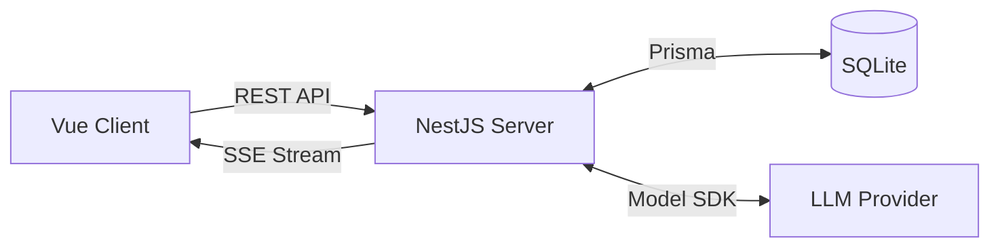
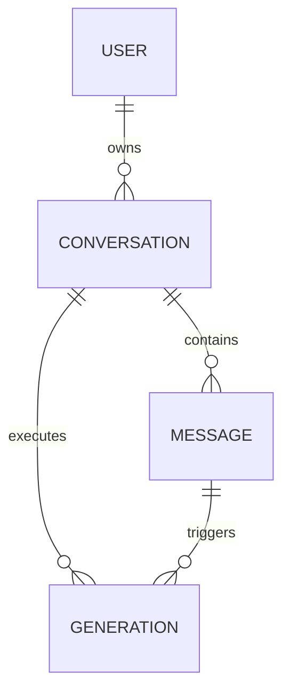
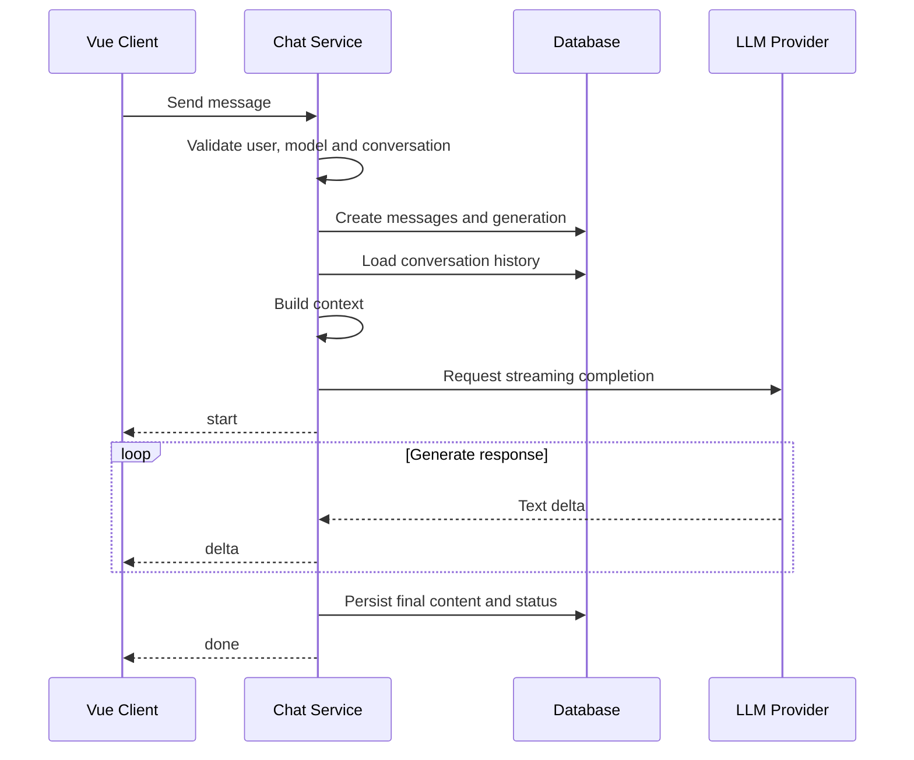
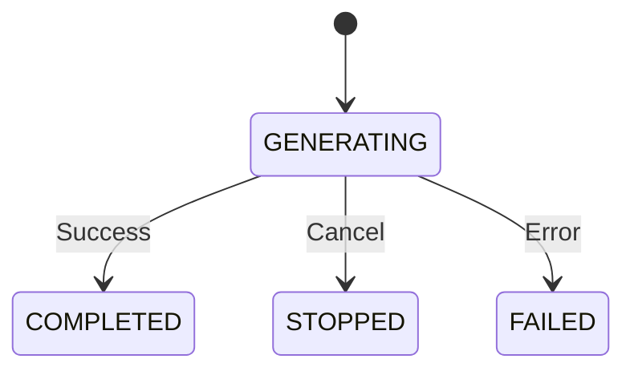

# AI Chat — Technical Design

## 1. Overview（项目概述）

基于 NestJS + Vue 3 实现一个 AI 聊天工具，支持大语言模型调用、流式响应、多轮对话及历史会话管理。

采用模块化单体架构，优先实现最小可行产品（MVP）。

### Goals

- 用户注册与登录
- AI 对话
- 流式响应
- Markdown 渲染
- 多轮对话与上下文管理
- 模型选择
- 会话创建、重命名及删除
- 历史消息查询
- 停止生成
- 重新生成

### Non-Goals

- RAG 知识库
- Function Calling
- MCP
- AI Agent
- Multi-Agent
- 长期记忆
- 联网搜索
- 多模态输入
- 文件上传
- 模型训练与微调

### Principles

- KISS：使用最简单的方式实现功能。
- YAGNI：不提前引入不必要的功能及架构。
- SoC：明确模块职责及边界。
- Security：保证必要的安全性。
- Testability：核心功能必须可验证。

优先完成基础设施连通性测试，再实现核心业务。

## 2. Technology Stack（技术栈）

**前端：** Vue 3、TypeScript、Vite、Vue Router、Pinia、Axios、Element Plus、Markdown-it、Highlight.js、DOMPurify、Vitest

**后端：** NestJS、TypeScript、Prisma、SQLite、OpenAI SDK、SSE、JWT、Argon2id、class-validator、Swagger、Jest、Supertest

**工程化：** pnpm Workspace、ESLint、Prettier、Git

**AI Provider：** OpenAI 或兼容 OpenAI Chat Completions API 的模型服务。

初期直接使用 OpenAI SDK，不引入 LangChain、LangGraph、Redis、Milvus、RabbitMQ 等额外依赖。

## 3. Architecture（系统架构）



- REST API：用户认证、会话管理、历史消息及模型查询。
- SSE：AI 生成内容的流式传输。
- Prisma：用户、会话及消息持久化。
- OpenAI SDK：调用大语言模型。

### Project Structure

采用 Monorepo 管理。

- `apps/web`：前端应用。
- `apps/server`：后端应用。
- `packages/shared`：公共类型、错误码及接口契约。

不引入复杂的 Repository、DDD、CQRS 或微服务架构。

## 4. Module Design（模块设计）

### 4.1 Health

负责基础设施连通性检查。

- HTTP 服务检查。
- 数据库连接检查。
- AI Provider 连通性检查。
- SSE 流式通信检查。

### 4.2 Auth

负责用户身份认证。

- 用户注册与登录。
- Argon2id 密码哈希。
- JWT Access Token。
- Token 过期后重新登录。

初期不实现 Refresh Token、Session 和 OAuth。

### 4.3 User

负责用户基本信息管理。

- 获取当前用户信息。
- 修改用户基本信息。
- 禁止返回密码哈希等敏感字段。

### 4.4 Conversation

负责 AI 对话会话管理。

- 创建会话。
- 查询会话列表。
- 查询会话详情。
- 修改会话标题。
- 删除会话。
- 按照最后活跃时间排序。

会话属于指定用户，禁止跨用户访问。

初期直接使用第一条用户消息的前 30 个字符作为会话标题，不额外调用 AI 生成标题。

### 4.5 Message

负责消息管理及持久化。

- 保存用户消息。
- 保存 AI 消息。
- 查询历史消息。
- 管理消息生成状态。
- 通过 requestId 防止重复提交。

消息角色分为 SYSTEM、USER、ASSISTANT。

初期 System Prompt 由服务端统一管理，不支持用户自定义。

### 4.6 Model

负责模型配置及调用。

- 获取可用模型列表。
- 校验模型是否可用。
- 初始化模型 SDK。
- 调用大语言模型。
- 处理模型服务异常。

初期使用服务端配置文件维护模型列表，不建立模型管理数据库。

```typescript
interface ModelConfig {
  id: string; // Public model identifier
  name: string; // Display name
  provider: string; // Model provider
  model: string; // Provider model identifier
  contextWindow: number; // Maximum context tokens
  maxOutputTokens: number; // Maximum output tokens
  enabled: boolean; // Availability
}
```

API Key、Base URL 通过服务端环境变量配置，不返回客户端。

### 4.7 Chat

负责 AI 对话核心业务。

- 校验会话所有权。
- 校验模型及用户输入。
- 保存用户消息。
- 构建上下文。
- 调用 Model Service。
- 流式返回 AI 响应。
- 保存 AI 回复。
- 停止生成。
- 重新生成。

Chat Service 负责业务编排，Model Service 负责模型调用，Message Service 负责数据持久化。

每个会话同时只允许存在一个生成任务。

### 4.8 Context

负责多轮对话上下文管理。

初期采用 Sliding Window 方式：

- 固定 System Prompt。
- 获取当前会话最近 20 条有效历史消息。
- 按照消息顺序构建上下文。
- 包含当前用户输入。
- 排除失败、生成中及已被替换的 AI 消息。
- 根据模型 Token 限制移除最早的历史对话。

不使用向量数据库、上下文摘要或长期记忆。

数据库中的历史消息不因上下文裁剪而删除。

### 4.9 Common

负责公共基础设施。

- 统一响应格式。
- 公共错误码。
- 全局异常处理。
- 参数校验。
- 日志及请求追踪。

### 4.10 Frontend

页面路由：

- `/login` — 登录页面
- `/register` — 注册页面
- `/chat` — AI 聊天首页
- `/chat/:conversationId` — 指定对话
- `/settings` — 用户设置

核心组件：

- ConversationList：历史会话列表。
- MessageList：消息列表。
- MessageItem：消息展示。
- ChatInput：消息输入。
- ModelSelector：模型选择。
- MarkdownRenderer：Markdown 渲染。
- CodeBlock：代码高亮及复制。
- GenerationActions：停止及重新生成。

使用 Pinia 管理 Auth、Conversation、Chat、Model 状态。

普通 HTTP 请求使用 Axios，流式请求使用 Fetch API + ReadableStream。

## 5. Database Design（数据库设计）

### 5.1 Data Model

| Table         | Fields                                                                                                    |
| ------------- | --------------------------------------------------------------------------------------------------------- |
| users         | id、username、passwordHash、nickname、createdAt、updatedAt                                                |
| conversations | id、userId、title、modelId、createdAt、updatedAt                                                          |
| messages      | id、conversationId、requestId、role、content、modelId、status、replacedAt、createdAt、updatedAt           |
| generations   | id、conversationId、requestId、userMessageId、assistantMessageId、status、errorCode、createdAt、updatedAt |

generations 用于记录生成任务、幂等标识及生成结果。

modelId 在用户消息中可以为空；replacedAt 用于标记被重新生成替换的 AI 消息。

### 5.2 ER Diagram



### 5.3 Constraints

- users.username：Unique
- conversations.userId：Foreign Key
- conversations.[userId, updatedAt]：Index
- messages.conversationId：Foreign Key
- messages.[conversationId, createdAt, id]：Index
- generations.[conversationId, requestId]：Unique
- generations.assistantMessageId：Unique
- 所有关联记录必须属于同一个会话。

### 5.4 Data Consistency

- 用户消息与生成任务必须通过事务创建。
- AI 消息在生成开始前创建，生成结束后更新内容及状态。
- 生成任务与 AI 消息的最终状态必须保持一致。
- 生成成功后更新会话活跃时间。
- 删除会话时级联删除相关消息及生成记录。
- 模型调用期间不得持有数据库事务。
- 服务重启后，将遗留的 GENERATING 任务标记为 FAILED。

初期使用单进程任务映射及会话锁限制并发生成，不引入分布式锁。

## 6. Interface Design（接口设计）

### 6.1 REST API

- Base URL：`http://localhost:3000`
- Prefix：`/api/v1`
- Authentication：Bearer Token
- Content-Type：application/json

#### Health

- `GET /health` — 服务健康检查
- `GET /health/ready` — 数据库就绪检查

#### Auth

- `POST /auth/register` — 用户注册
- `POST /auth/login` — 用户登录

#### User

- `GET /users/me` — 获取当前用户信息
- `PATCH /users/me` — 修改当前用户信息

#### Model

- `GET /models` — 获取可用模型列表

#### Conversation

- `POST /conversations` — 创建会话
- `GET /conversations` — 获取会话列表
- `GET /conversations/:id` — 获取会话详情
- `PATCH /conversations/:id` — 修改会话标题及默认模型
- `DELETE /conversations/:id` — 删除会话

#### Message

- `GET /conversations/:id/messages` — 获取历史消息

#### Chat

- `POST /conversations/:id/chat` — 发送消息并流式生成
- `POST /conversations/:id/chat/regenerate` — 重新生成最后一条 AI 回复
- `POST /conversations/:id/chat/stop` — 停止指定生成任务
- `GET /conversations/:id/generations/:requestId` — 查询生成任务状态

Health、注册及登录接口无需认证，其余接口均需要 JWT 认证。

### 6.2 Streaming API

- Protocol：HTTP Streaming / SSE
- Content-Type：text/event-stream
- Client：Fetch API + ReadableStream
- Encoding：UTF-8

事件定义：

- `start` — 开始生成，返回 requestId 及消息 ID
- `delta` — 返回增量文本
- `usage` — 返回 Token 使用量（模型支持时）
- `done` — 生成结束及最终状态
- `error` — 返回生成过程中的异常

生成正常完成或主动停止时发送 done；生成失败时发送 error 并结束流。

流式接口不使用普通 JSON Response 包装。

采用 POST 请求发送用户输入，通过 Fetch API 消费 SSE 响应，不使用原生 EventSource。

## 7. Common Types（公共类型）

公共类型统一定义在 `packages/shared`。

### 7.1 API Response

```typescript
export interface APIResponse<T = unknown> {
  code: ErrorCode; // Business status code
  message: string; // Response message
  data: T | null; // Response payload
  requestId: string; // HTTP request identifier
  timestamp: string; // ISO 8601 UTC timestamp
}
```

### 7.2 Pagination

```typescript
export interface PageResult<T> {
  items: T[]; // Page items
  total: number; // Total items
  page: number; // Current page
  pageSize: number; // Items per page
}

export interface CursorResult<T> {
  items: T[]; // Page items
  nextCursor: string | null; // Next page cursor
  hasMore: boolean; // More items available
}
```

### 7.3 Message

```typescript
export const enum MessageRole {
  SYSTEM = "system",
  USER = "user",
  ASSISTANT = "assistant",
}

export const enum GenerationStatus {
  GENERATING = "generating", // Generation in progress
  COMPLETED = "completed", // Generation completed
  STOPPED = "stopped", // Cancelled by user
  FAILED = "failed", // Generation failed
}

export interface ChatMessage {
  id: string;
  conversationId: string;
  requestId: string;
  role: MessageRole;
  content: string;
  modelId: string | null;
  status: GenerationStatus;
  createdAt: string;
}
```

### 7.4 Stream Event

```typescript
export type StreamEvent =
  | {
      type: "start";
      requestId: string;
      messageId: string;
    }
  | {
      type: "delta";
      content: string;
    }
  | {
      type: "usage";
      inputTokens: number;
      outputTokens: number;
    }
  | {
      type: "done";
      messageId: string;
      status: GenerationStatus.COMPLETED | GenerationStatus.STOPPED;
    }
  | {
      type: "error";
      code: ErrorCode;
      message: string;
    };
```

### 7.5 Error Code

```typescript
export const enum ErrorCode {
  SUCCESS = 0, // HTTP 200 / 201

  // Common
  VALIDATION_ERROR = 1001, // HTTP 400
  BAD_REQUEST = 1002, // HTTP 400
  UNAUTHORIZED = 1003, // HTTP 401
  FORBIDDEN = 1004, // HTTP 403
  NOT_FOUND = 1005, // HTTP 404
  CONFLICT = 1006, // HTTP 409
  TOO_MANY_REQUESTS = 1007, // HTTP 429

  // Authentication
  INVALID_CREDENTIALS = 2001, // HTTP 401
  TOKEN_EXPIRED = 2002, // HTTP 401
  TOKEN_INVALID = 2003, // HTTP 401

  // User
  USER_NOT_FOUND = 3001, // HTTP 404
  USERNAME_ALREADY_EXISTS = 3002, // HTTP 409

  // Conversation
  CONVERSATION_NOT_FOUND = 4001, // HTTP 404
  CONVERSATION_FORBIDDEN = 4002, // HTTP 403
  CONVERSATION_BUSY = 4003, // HTTP 409

  // Message
  MESSAGE_NOT_FOUND = 5001, // HTTP 404
  MESSAGE_CONTENT_EMPTY = 5002, // HTTP 400
  MESSAGE_CONTENT_TOO_LONG = 5003, // HTTP 400
  REQUEST_ID_CONFLICT = 5004, // HTTP 409

  // Model
  MODEL_NOT_FOUND = 6001, // HTTP 404
  MODEL_UNAVAILABLE = 6002, // HTTP 503
  MODEL_REQUEST_FAILED = 6003, // HTTP 502
  MODEL_REQUEST_TIMEOUT = 6004, // HTTP 504
  MODEL_RATE_LIMIT = 6005, // HTTP 429
  MODEL_CONTEXT_EXCEEDED = 6006, // HTTP 400
  MODEL_QUOTA_EXCEEDED = 6007, // HTTP 503
  MODEL_AUTH_FAILED = 6008, // HTTP 502
  MODEL_CONTENT_FILTERED = 6009, // HTTP 422

  // Generation
  GENERATION_NOT_FOUND = 7001, // HTTP 404
  GENERATION_FAILED = 7002, // HTTP 500
  GENERATION_NOT_ACTIVE = 7003, // HTTP 409
  STREAM_INTERRUPTED = 7004, // Client-side error

  // Infrastructure
  INTERNAL_SERVER_ERROR = 9001, // HTTP 500
  DATABASE_UNAVAILABLE = 9002, // HTTP 503
  SERVICE_UNAVAILABLE = 9003, // HTTP 503
}
```

HTTP 注释表示流式响应开始之前的状态码映射。

流式响应开始后发生的错误，通过 SSE error 事件返回，不再修改 HTTP 状态码。

公共 const enum 必须验证前后端构建兼容性；如果独立编译不支持，则使用普通 enum 或 as const 对象。

## 8. Error Handling（异常处理）

### 8.1 Business Exception

```typescript
export class BusinessException extends Error {
  constructor(
    public readonly code: ErrorCode,
    message: string,
  ) {
    super(message);
    this.name = "BusinessException";
  }
}
```

### 8.2 Backend

- ValidationPipe：参数校验。
- AuthGuard：身份认证及权限校验。
- BusinessException：业务异常。
- ExceptionFilter：统一 HTTP 异常处理。
- ResponseInterceptor：普通响应格式化。
- Stream Handler：流式响应及异常处理。
- Logger：关键操作及异常记录。

模型 SDK 异常统一转换为项目内部错误码，禁止直接返回第三方服务异常。

ResponseInterceptor 应跳过流式接口。

### 8.3 Streaming Error

流式响应需要区分两个阶段。

**响应开始前：**

使用 HTTP 状态码及 APIResponse 返回异常。

**响应开始后：**

- 保存已生成的部分内容。
- 更新生成任务及消息状态。
- 发送 error 事件（连接仍然可用时）。
- 结束响应流。
- 释放生成任务相关资源。

### 8.4 Frontend

- HTTP 401：Token 失效时重新登录。
- HTTP 403：提示权限不足。
- HTTP 429：提示请求频繁。
- HTTP 5xx：提示服务异常。
- Stream Error：保留已生成内容并显示异常。
- Network Error：查询生成任务状态及历史消息。
- Model Error：提示模型不可用或生成失败。

### 8.5 Rules

- 禁止吞掉异常。
- 禁止返回虚假成功结果。
- 禁止暴露 API Key、Token、SQL 及内部堆栈。
- 禁止通过异常消息字符串判断业务错误。
- 禁止流式生成失败后自动重复调用模型。
- 日志默认不记录完整 Prompt 及 AI 回复。

## 9. Core Workflow（核心业务流程）

### 9.1 Chat Generation



核心实现逻辑（伪代码）：

```typescript
async function generateMessage(context) {
  const generation = await createGeneration(context);

  let content = "";

  try {
    const messages = await buildContext(generation);

    const stream = await modelService.stream({
      messages,
      signal: generation.signal,
    });

    for await (const delta of stream) {
      content += delta;
      emit("delta", { content: delta });
    }

    await completeGeneration(generation.id, content);

    emit("done", {
      messageId: generation.assistantMessageId,
      status: GenerationStatus.COMPLETED,
    });
  } catch (error) {
    await finalizeInterruptedGeneration(generation, content, error);
  } finally {
    releaseGeneration(generation.id);
  }
}
```

finalizeInterruptedGeneration 需要区分主动取消与生成失败，并更新数据库状态及发送对应的结束事件。

初期在内存中累积 AI 回复，结束或取消时统一持久化，不为每个 Token 单独写入数据库。

### 9.2 Context Management

上下文组成：

```text
System Prompt
    +
Recent Conversation History
    +
Current User Message
```

核心逻辑：

```typescript
const messages = [systemMessage, ...recentHistory, currentUserMessage];
```

recentHistory 不包含当前用户消息，避免重复输入。

按照模型的上下文窗口及最大输出 Token 数量裁剪历史消息，优先保留完整的最近对话。

### 9.3 Stop Generation

使用 AbortController 取消模型请求。

```typescript
const activeGenerations = new Map<string, AbortController>();
```

停止流程：

1. 校验生成任务所属用户。
2. 获取对应的 AbortController。
3. 调用 abort() 取消模型请求。
4. 保存已生成的内容。
5. 将任务及消息状态更新为 STOPPED。
6. 结束 SSE 响应。

客户端连接主动断开时，也应取消对应模型请求。

取消为尽力而为，不保证模型服务立即停止计费。

### 9.4 Regenerate

初期仅支持重新生成最后一条 AI 回复。

- 复用对应的用户消息。
- 不重复创建用户消息。
- 使用新的 requestId 创建生成任务。
- 排除原 AI 回复，重新构建上下文。
- 新回复成功完成后，将原 AI 回复标记为已替换。
- 如果重新生成失败，保留原回复。

暂不支持历史消息编辑、对话分支及版本切换。

### 9.5 Message State



重新生成时创建新的生成任务，不直接修改旧任务状态。

### 9.6 Idempotency

- 每次生成请求使用 UUID 作为 requestId。
- 相同 requestId 不允许重复调用模型。
- 相同 requestId 对应不同请求内容时返回冲突错误。
- 重复请求时查询已有生成任务及消息。
- 网络异常后，优先查询生成任务状态，不自动重新生成。
- 同一会话存在生成任务时，拒绝新的生成请求。

初期不支持 SSE 断点续传，连接中断后通过 HTTP 查询已保存的消息及任务状态。

### 9.7 Security

- 模型 API Key 仅保存在服务端。
- 所有会话、消息及生成任务均校验用户所有权。
- 用户输入进行长度限制及 Token 校验。
- 模型调用设置超时及最大输出 Token 数量。
- 登录及生成请求进行基础限流。
- Markdown 默认禁用原始 HTML，并对渲染结果进行净化。
- System Prompt 不存放密钥及敏感信息。
- 模型生成内容视为不可信数据。
- 生产环境使用 HTTPS。

## 10. Connectivity Testing（连通性测试）

在实现完整业务之前，优先验证各项技术是否能够正常工作。

### 10.1 HTTP

```bash
curl http://localhost:3000/api/v1/health
curl http://localhost:3000/api/v1/health/ready
```

预期结果：服务及数据库正常时返回 HTTP 200，数据库不可用时就绪检查返回 HTTP 503。

### 10.2 Database

```typescript
await prisma.$queryRaw`SELECT 1`;
```

预期结果：Prisma 正常连接数据库并执行查询。

### 10.3 Model Provider

使用最简单的方式验证模型调用。

```typescript
import OpenAI from "openai";

const client = new OpenAI({
  apiKey: process.env.AI_API_KEY,
  baseURL: process.env.AI_BASE_URL,
});

const response = await client.chat.completions.create({
  model: process.env.AI_MODEL!,
  messages: [
    {
      role: "user",
      content: "Reply with OK.",
    },
  ],
});

console.log(response.choices[0]?.message.content);
```

预期结果：模型服务正常返回文本内容。

重点验证 API Key、Base URL、模型名称及模型协议兼容性。

### 10.4 Model Streaming

```typescript
const stream = await client.chat.completions.create({
  model: process.env.AI_MODEL!,
  messages: [
    {
      role: "user",
      content: "Introduce yourself briefly.",
    },
  ],
  stream: true,
});

for await (const chunk of stream) {
  process.stdout.write(chunk.choices[0]?.delta.content ?? "");
}
```

预期结果：模型内容逐步输出，而不是等待完整响应后一次性返回。

### 10.5 SSE Streaming

开发阶段创建临时 SSE 测试接口，定时返回固定文本。

```bash
curl -N http://localhost:3000/api/v1/health/stream
```

预期结果：

- 客户端能够持续接收增量内容。
- SSE 事件能够正确解析。
- 事件跨数据块时仍可正确拼接。
- 响应不会被代理或压缩中间件缓冲。
- 连接能够正常结束及取消。

测试完成后移除临时接口，或仅在开发环境启用。

### 10.6 Business Testing

| 测试场景       | 预期结果               |
| -------------- | ---------------------- |
| 用户注册及登录 | 正常认证               |
| 创建会话       | 成功保存               |
| 发送消息       | AI 正常响应            |
| 流式生成       | 内容逐步展示           |
| 多轮对话       | 正确携带上下文         |
| 刷新页面       | 恢复历史消息           |
| 停止生成       | 取消请求并保存部分内容 |
| 重新生成       | 不重复创建用户消息     |
| 重复 requestId | 不重复调用模型         |
| 并发生成       | 拒绝同一会话的重复任务 |
| 模型调用失败   | 返回对应错误码         |
| 模型响应超时   | 结束任务并释放资源     |
| 网络中断       | 正确处理任务状态       |
| 跨用户访问     | 拒绝访问               |
| 恶意 Markdown  | 不执行危险内容         |

自动化测试使用 Mock Model Provider 及独立数据库，避免重复消耗真实模型额度。

## 11. Configuration（配置管理）

### Backend

```dotenv
NODE_ENV=development
PORT=3000
APP_ORIGIN=http://localhost:5173

DATABASE_URL=file:./dev.db

JWT_SECRET=replace-with-secure-secret
JWT_EXPIRES_IN=3600

AI_API_KEY=
AI_BASE_URL=https://api.openai.com/v1
AI_MODEL=
AI_REQUEST_TIMEOUT_MS=120000
AI_MAX_OUTPUT_TOKENS=4096
AI_CONTEXT_MAX_MESSAGES=20

CHAT_MAX_INPUT_LENGTH=10000
```

### Frontend

```dotenv
VITE_API_BASE_URL=http://localhost:3000/api/v1
```

启动时校验必要环境变量。

模型名称、输出长度及上下文限制必须符合实际 Provider 的能力。

## 12. Implementation Plan（实施计划）

| Phase | Task                   | Acceptance Criteria           |
| ----- | ---------------------- | ----------------------------- |
| 01    | Initialization         | NestJS、Vue 正常启动          |
| 02    | Connectivity           | HTTP、Database、LLM、SSE 连通 |
| 03    | Common Infrastructure  | 公共类型、错误码、异常处理    |
| 04    | Auth & User            | 用户注册、登录及认证          |
| 05    | Model                  | 模型配置及 SDK 调用           |
| 06    | Basic Chat             | 单轮对话及流式响应            |
| 07    | Conversation & Message | 会话管理及消息持久化          |
| 08    | Context                | 多轮对话及上下文裁剪          |
| 09    | Generation Control     | 停止生成、重新生成及幂等      |
| 10    | Frontend Integration   | 完整 AI 聊天页面              |
| 11    | Testing & Delivery     | 测试、构建及文档              |

每个阶段必须完成对应的验证，再进入下一阶段。

## 13. Future Work（后续演进）

| 功能              | 当前方案             | 后续方案               |
| ----------------- | -------------------- | ---------------------- |
| Model Integration | OpenAI SDK           | Multi-Provider Adapter |
| Context           | Sliding Window       | Context Compression    |
| Memory            | Conversation History | Long-Term Memory       |
| Knowledge         | 无                   | RAG                    |
| Tools             | 无                   | Function Calling / MCP |
| Agent             | 无                   | ReAct / LangGraph      |
| Database          | SQLite               | PostgreSQL             |
| Task Management   | In-Memory Map        | Redis / Message Queue  |
| Streaming         | HTTP + SSE           | 可恢复的事件流         |
| Usage             | 基础 Token 统计      | Quota / Billing        |

根据实际需求逐步演进，不提前引入复杂架构。

## 14. Definition of Done（验收标准）

- [ ] 前后端正常启动。
- [ ] HTTP、数据库及模型连通性测试通过。
- [ ] SSE 流式响应正常。
- [ ] 用户能够注册及登录。
- [ ] 用户能够创建及管理会话。
- [ ] AI 能够进行单轮及多轮对话。
- [ ] Markdown 及代码块正常渲染。
- [ ] 消息能够持久化及恢复。
- [ ] 停止生成及重新生成正常。
- [ ] 上下文管理及 Token 限制正常。
- [ ] 消息幂等性及权限校验正常。
- [ ] 模型异常及网络异常正确处理。
- [ ] 核心测试及构建检查通过。
- [ ] README 包含安装、配置及启动说明。
