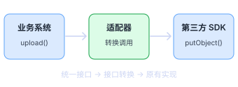

# 适配器模式(Adapter Pattern)

## 适配器的出现
1. 两个类或模块 系统接口不兼容, 但是又希望它们之间能够协同工作 在不改动原有代码情况下实现兼容

我们生活中也可以看到适配器模式, 平常我们 只要是 国标的电源插头 都是一个标准, 二口或三插口的规格, 但是在其他国家若是要使用我们的插头来接入他们的接口 我们就需要转换器来进行转换

适配器模式 也是和上述类似的情况


2. 软件开发场景:
- 多OSS场景: 业务系统调用 upload, 我们通过 适配器所抛出的接口来调用 第三方 SDK, 这里的适配器并不重新实现第三方SDK而是兼容第三方SDK
  - 
- 多 IM 场景

## 适配器演进过程

这里我们以 [AssetStack](https://github.com/Like-Su/AssetStack) 我们项目中所遇到的问题为主来讲解 适配器模式 实际应用场景

我们的项目可能会用到 `RustFS` 也可以用上 `本地存储` 或者 `其他OSS`

我们最初系统可能是先用 本地存储 但是后续上线后切换到 `RustFS` 或 `其他OSS`

我们先看看如果是最初代码是什么样子的呢?, 下面实现是经过简化的 目的是未来 专注于 设计模式而非实现上
```ts
// storage.service.ts
@Injectable()
export class StorageService {
  private readonly root = resolve('./uploads');

  // 创建文件
  async create(key: string, data: Buffer) {
    const path = resolve(this.root, key);

    await mkdir(dirname(path), { recursive: true });
    await writeFile(path, data);
  }

  // 读取文件
  async findOne(key: string): Promise<Buffer> {
    return readFile(resolve(this.root, key));
  }

  // 更新文件
  async update(key: string, data: Buffer) {
    await writeFile(resolve(this.root, key), data);
  }

  // 删除文件
  async delete(key: string) {
    await unlink(resolve(this.root, key));
  }
}
```

在项目初期我们只须要使用 本地上传用户文件, 因此通过 文件系统完成, 随着项目迭代我们希望支持 OSS 并保留未来接入其他对象存储服务的能力, 所以现在对 StorageService 职责划分出现问题

下面就是一个适配 oss 和 local 的代码, 我们可以发现耦合度是非常高的

我们的需求从 本地存储 到 对象存储服务的转变 原有架构无法进行优雅的扩展, 所以我们必须重构下面代码

```ts
@Injectable()
export class StorageService implements OnModuleInit, OnModuleDestroy {
  private storage?: S3Client;
  private bucket = '';
  private localPath = '';
  private driver!: 'local' | 'oss';

  constructor(
    @Inject(ConfigService)
    private readonly config: ConfigService<Environment>,
  ) {}

  async onModuleInit() {
    await this.initialize();
  }

  onModuleDestroy() {
    this.storage?.destroy();
  }

  // 初始化存储
  async initialize() {
    const driver = this.config.get<string>('STORAGE_DRIVER', 'local');

    if (driver !== 'local' && driver !== 'oss') {
      throw new Error(`不支持的存储类型: ${driver}`);
    }

    this.driver = driver;

    if (this.driver === 'local') {
      this.localPath = resolve(
        this.config.get<string>('LOCAL_STORAGE_PATH', './uploads'),
      );

      await mkdir(this.localPath, { recursive: true });
      return;
    }

    const get = (key: string) => this.config.getOrThrow<string>(key);

    this.bucket = get('RUSTFS_BUCKET');
    this.storage = new S3Client({
      endpoint: get('RUSTFS_ENDPOINT'),
      region: get('RUSTFS_REGION'),
      credentials: {
        accessKeyId: get('RUSTFS_ACCESS_KEY'),
        secretAccessKey: get('RUSTFS_SECRET_KEY'),
      },
      forcePathStyle: true,
    });
  }

  // 本地文件路径：防止 ../ 路径穿越
  private getPath(key: string) {
    if (!key) throw new BadRequestException('文件 Key 不能为空');

    const path = resolve(this.localPath, key);
    const rel = relative(this.localPath, path);

    if (!rel || rel === '..' || rel.startsWith(`..${sep}`) || isAbsolute(rel)) {
      throw new BadRequestException('非法文件路径');
    }

    return path;
  }

  // 创建文件
  async create(key: string, data: Buffer, contentType?: string) {
    if (this.driver === 'local') {
      const path = this.getPath(key);
      await mkdir(dirname(path), { recursive: true });
      await writeFile(path, data);
      return;
    }

    await this.storage!.send(new PutObjectCommand({
      Bucket: this.bucket,
      Key: key,
      Body: data,
      ContentType: contentType,
    }));
  }

  // 查询文件
  async findOne(key: string): Promise<Buffer> {
    if (this.driver === 'local') {
      return readFile(this.getPath(key));
    }

    const result = await this.storage!.send(new GetObjectCommand({
      Bucket: this.bucket,
      Key: key,
    }));

    if (!result.Body) throw new Error('文件内容为空');

    return Buffer.from(await result.Body.transformToByteArray());
  }

  // 更新文件
  async update(key: string, data: Buffer, contentType?: string) {
    return this.create(key, data, contentType);
  }

  // 删除文件
  async delete(key: string) {
    if (this.driver === 'local') {
      await unlink(this.getPath(key));
      return;
    }

    await this.storage!.send(new DeleteObjectCommand({
      Bucket: this.bucket,
      Key: key,
    }));
  }

  // 临时下载链接：仅 OSS 支持
  async getDownloadUrl(key: string, expiresIn = 3600) {
    if (this.driver === 'local') return null;

    return getSignedUrl(
      this.storage!,
      new GetObjectCommand({ Bucket: this.bucket, Key: key }),
      { expiresIn },
    );
  }

  // 临时上传链接：仅 OSS 支持
  async getUploadUrl(key: string, expiresIn = 600) {
    if (this.driver === 'local') return null;

    return getSignedUrl(
      this.storage!,
      new PutObjectCommand({ Bucket: this.bucket, Key: key }),
      { expiresIn },
    );
  }
}
```

在我们上例中 业务层需要得知 存储类型, 根据存储类型来判断需要使用哪一个存储方式, 若我们不在业务层中判断存储类型 那么我们就要在 接口层进行判断, 这是需要解决的问题 只不过分为 如何解决怎么解决更加优雅的一个问题

这里我将代码简化一下你可以看的更加清楚

```ts
class StorageService {
 // 创建文件
  async create(key: string, data: Buffer, contentType?: string) {
    if (this.driver === 'local') {
      // 调用本地读写文件 API
    }

    // 调用 S3 上传文件 API
  }
}
```


我们需要在业务层和具体实现存储之间引入一个统一契约  StorageAdapter

业务层只依赖该契约而不同适配器负责将契约中方法转换为 各存储系统所支持的方法 比如 `RustfsStroageAdapter.create` 转换为 `putObject`, `LocalStorageAdapter.create` 转换为 Node 文件系统的 `writeFile`, 所以适配器并不是重新实现整个存储系统而是根据已有能力进行 **接口适配**

介绍一下我们目录规划 其中 `storageService.ts` 是Service层业务代码
```
/storage
  storage.service.ts 业务层
  storage.adapter.ts 抽象实现
  rustfs.adapter.ts 具体实现
  storage.progvider.ts 注入配置
```
```ts
class StorageService implements onModuleDestroy {
  constructor(
    @Inject(StorageProvider)
    private readonly provider: StorageProvider
  ) {}
  async create(key: string, data: Buffer, contentType?: string) {
    return this.provider.create(key, data, contentType);
  }
   async findOne(key: string) {
    return this.provider.findOne(key);
  }

  async update(key: string, data: Buffer, contentType?: string) {
    return this.provider.update(key, data, contentType);
  }

  async delete(key: string) {
    return this.provider.delete(key);
  }
}
```

这里我们重点看看抽象实现, 在下面我们主要定义一个抽象类对公用进行方法进行 定义
```ts
// storage.adapter.ts

// 实现一个抽象类
export abstract class StorageAdapter {
  abstract create(
    key: string,
    data: Buffer,
    contentType?: string,
  ): Promise<void>;

  abstract findOne(key: string): Promise<Buffer>;

  abstract update(
    key: string,
    data: Buffer,
    contentType?: string,
  ): Promise<void>;

  abstract delete(key: string): Promise<void>;

  // 默认不需要释放资源
  destroy(): void {}
}
```

这里我们先实现 本地的 adapter, 继承一下抽象类进行实现 抽象方法, 默认方法你可以重写也可以不是先 因为 本地文件无需释放, 因为 fs 模块已经帮我们做了 文件句柄释放
```ts
// local.adapter.ts
export class LocalStorageAdapter extends StorageAdapter {
  private readonly name: 'local' | 'oss' = 'local';
  private readonly root: string;

  constructor(path: string) {
    super();
    this.root = resolve(path);
  }

  private getPath(key: string) {
    const path = resolve(this.root, key);
    const rel = relative(this.root, path);

    if (
      !key ||
      key.includes('\\') ||
      !rel ||
      rel === '..' ||
      rel.startsWith(`..${sep}`) ||
      isAbsolute(rel)
    ) {
      throw new BadRequestException('非法文件路径');
    }

    return path;
  }

  async create(key: string, data: Buffer) {
    const path = this.getPath(key);
    await mkdir(dirname(path), { recursive: true });
    await writeFile(path, data);
  }

  async findOne(key: string) {
    return readFile(this.getPath(key));
  }

  async update(key: string, data: Buffer) {
    return this.create(key, data);
  }

  async delete(key: string) {
    await unlink(this.getPath(key));
  }
}
```

接下里我们实现 RustFS 的适配器, 这里我们主要导入 `ConfigService` 进行环境变量注入提取 创建一个 S3 的实例, 后续对 RustFS 的操作都是基于 S3 实例提供的 API 基础上对器进行防御性编程操作
```ts
export class RustfsStorageAdapter extends StorageAdapter {
  private readonly name: 'local' | 'oss';
  private readonly client: S3Client;
  private readonly bucket: string;

  constructor(config: ConfigService) {
    super();

    const get = (key: string) => config.getOrThrow<string>(key);

    this.bucket = get('RUSTFS_BUCKET');

    this.client = new S3Client({
      endpoint: get('RUSTFS_ENDPOINT'),
      region: get('RUSTFS_REGION'),
      credentials: {
        accessKeyId: get('RUSTFS_ACCESS_KEY'),
        secretAccessKey: get('RUSTFS_SECRET_KEY'),
      },
      forcePathStyle: true,
    });
  }

  async create(key: string, data: Buffer, contentType?: string) {
    await this.client.send(new PutObjectCommand({
      Bucket: this.bucket,
      Key: key,
      Body: data,
      ContentType: contentType,
    }));
  }

  async findOne(key: string): Promise<Buffer> {
    const result = await this.client.send(new GetObjectCommand({
      Bucket: this.bucket,
      Key: key,
    }));

    if (!result.Body) throw new Error('文件内容为空');

    return Buffer.from(await result.Body.transformToByteArray());
  }

  async update(key: string, data: Buffer, contentType?: string) {
    return this.create(key, data, contentType);
  }

  async delete(key: string) {
    await this.client.send(new DeleteObjectCommand({
      Bucket: this.bucket,
      Key: key,
    }));
  }

  override destroy() {
    this.client.destroy();
  }
}
```

我们实现起来, 但是还有一个问题是我们如何将这两个 适配器实现类 组装起来呢? 根据环境变量配置来自主选择, 这里我们采用一个 `注册中心 + 工厂函数 + 懒加载` 与 `单例` 的组合方案

该设计核心就是 一个 Provider 保存一个适配器
```ts
type ProviderType = 'oss' | 'local'
type StorageFactory = () => StorageAdapter
export class StorageProvider {
  // 保存适配器
  private readonly providerMap: Map<ProviderType, StorageFactory> = new Map<ProviderType, StorageFactory>();
  private adapter?: StorageAdapter;

  constructor(
    @Inject(ConfigService)
    private readonly config: ConfigService<Environment>
  ) {}

  get() {
    if(this.adapter) return this.adapter

    const type = this.config.getOrThrow<ProviderType>('STORAGE_PROVIDER');

    const factory = this.providerMap.get(type)

    if (!factory) {
      throw new Error(`未注册存储适配器: ${type}`);
    }

    return (this.adapter = factory())

  }

  register(type: ProviderType, factory: StorageFactory) {
    if (this.providerMap.has(type)) {
      throw new Error(`适配器 ${type} 已注册`);
    }
    this.providerMap.set(type, factory)
    // 形成 调用链
    return this
  }

  get provider() {
    return this.get();
  }

  onModuleDestroy() {
    this.adapter?.destroy();
  }
}
```
我们通过Module 模块来实现 Provider 的注册
```ts
@Module({
  imports: [ConfigModule],
  providers: [
    {
      provide: StorageProvider,
      inject: [ConfigService],
      useFactory: (config: ConfigService<Environment>) => {
        const provider = new StorageProvider(config);
        const adapter = {
          [LocalStorageAdapter.name]: () => new LocalStorageAdapter(config.get<string>('LOCAL_STORAGE_PATH', './uploads')),
          [RustfsStorageAdapter.name]: () => new RustfsStorageAdapter(config)
        }

        // 链式注册
        provider
        .register(LocalStorageAdapter.name adapter.local) // 注册 local
        .register(RustfsStorageAdapter.name, adapter.oss); // 注册 RustFS

        return provider;
      },
    },
  ],
})
export class StorageModule {}
```
