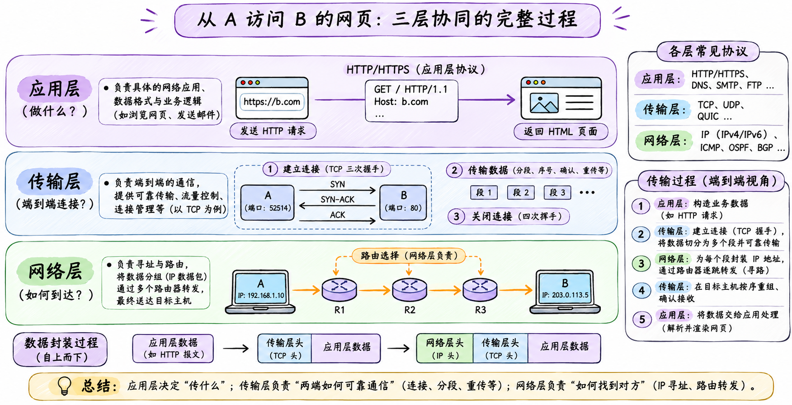
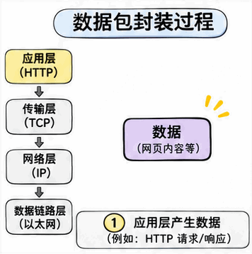
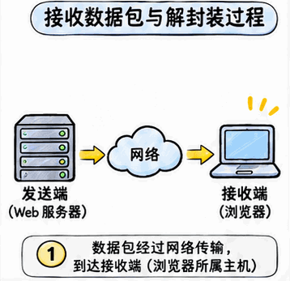

# TCP/IP

## TCP/IP 模型

TCP/IP 模型解决的问题就是 **如何让数据 跨网络/跨设备/跨厂商 的 数据交换标准 协议**.

若没有了 TCP/IP 还可以让两台电脑相互通信嘛 这是可以的 因为 两台电脑相互通信有多种解决方案 这里我们最简单的解决方案就是 连接网线, 第二种就是通过 我们自定义开发一套标准的通信协议 让两台计算机遵守我们开发的 通信协议 进行 数据的 发送/传输/接收

- 通过网线互通数据:

如图A发送 `Hello World` 给 B, 该数据是需要经过 编码 变为 比特, 模拟化为 物理信号 在通过电信号,光信号 进行物理传输, 无法直接传输比特

接下来我们就会遇到一些列问题, 我们可以根据现在所遇到的问题设计一套通信协议

- 如何传输数据(如何将 0 和 1 转换为物理信号)
- 如何识别数据(从哪里开始, 从哪里结束)
- 发给谁(如何识别目标设备)
- 数据丢失怎么办(重传机制)
- 数据太大怎么办(分段上传在重新组合 和 大文件上传是相似的)
- 不同同一个网络怎么办(寻址和路由)
- 收到数据后怎么办(如何交给对应程序处理)

若是其他人用我们还需要用这个协议的话 那么就将其定义为一个 **业界标准协议**, 就是 在当前行业中只要使用你的这套技术 那么就需要按照你所规定的标准进行实现, 若是不按该协议实现那么就会出现 无法兼容问题

- 万能协议
  这个协议主要是负责 信号传输, 数据格式, 设备寻址, 路由选择, 重传机制, 应用消息处理, 但是这里将所有功能都耦合在一起 体积非常庞大 从程序视角来看就是常见的 就是 **可插拔能力不强**

### 应用层(顶部)

TCP/IP 模型顶层 它是我们生活中可以直接接触到的, 比如 我们 浏览器,IM,视频软件,AIChat 等等都是建立在应用层上的, 当软件需要通信时 就会将数据传递给 传输层
应用层只专注于 HTTP/FTP/SMTP/Telent/DNS 等服务, 它并不关心数据如何传输

### 传输层

1. 协议分类
   传输层是为应用层提供网络支持, 该层拥有 TCP 和 UDP 两个协议

2. TCP/UDP 之间区别
   有许多服务是基于 TCP 实现的, TCP 是可靠的, UDP 是不可靠的, 这里我们来认识一下它们之间区别

TCP 拥有 流量控制, 超时重传, 拥塞控制
UDP 只负责发送数据包, 不保证 数据包能到达对方(UDP 也是可以实现可靠传输的)

你可以发现 TCP 所作的就是尽力将数据包送到对方手上而UDP则相反发送了就没有我的事情了

既然有两个协议就有他们的应用场景, 对数据严格要求的 使用 HTTP, 比如 游戏 这个一般使用 UDP 因为 **实时性更强**

3. 数据包分段
   数据包分段是为了节省性能 这里我们引入一个 开发场景 大文件上传 切片上传, 当一个 1GB 大文件上传给 OSS 这里时间占用的因素非常多(IO/Network) 两个主要因素, 而1个1GB的文件上传效率是非常低下,等待上传完成可能需要1~3分钟, 上传中途出现网络问题或错误 用户是需要重新上传的.

但是我们通过 切片上传 将文件切分为 一个个 固定大小的片段并打上序号 这时候我们上传时由于文件时切位一个个小片段所以网络上传效率非常高, 同时出现网络错误或上传错误时我们只须要上传上传失败的分片即可

在网络传输中数据包分段也是为了实现 **性能的提升** ,网络传输过程丢包或者数据包损坏 只须要重新发送这一个分块无需整个重新发送, 在 TCP 中我们也曾为 **TCP 段(TCP Segment)**

4. 打标签区分服务
   设备作为接收方 传输层 要将数据包传递给应用时是如何区分的呢? 一套计算机拥有非常多的服务, 而区分的解决方案就是 **端口(Port)**

那么浏览器标签页那么多 相同的网页服务 而且 Web 服务使用 80 端口 这又是如何分辨呢? **但是对于浏览器 标签页都是一个独立的进程 操作系统将其分配给临时的端口号**

### 网络层(Internet layer)

1. 网络层作用:

我们学习传输层它的作用是从一个设备传输到另一个设备上, 但是 网络寻路 的路线是 网络层来解决的, 网络层解决的正式 如何用最短路径 到达对方设备上

2. 网络层协议

网络层最常用协议就是 **IP(Internet Protocol)**

IP 会对传输层报文做的操作就是 **首部添加 IP 报头 转变为 IP 报文 和 分片(分片 条件是 IP 报文大小超过 MTU 1500 Byte)**

3. 寻址
世界那么多设备网络层如何寻路呢?
这就是 IP 的作用 给每个设备 打上编号 就是 IP 地址, 这里分为 **Ipv4/Ipv6** 两个协议, 通过 IP 来做到 设备区分

如何寻址 世界设备非常多 一个个匹配是不可能的, 所以将 IP 分为 网络号(负责 寻找 IP 属于那个网络) 和主机号(负责 寻找 子网下的设备)

又引出一个问题 该如何划分子网呢?
这里我们通过 10.26.100.123/24 这个 IP 来演示, 24 表示 子网掩码 `255.255.255.0` 表示 这个网络可以分配多少 IP

如何计算 网络地址和主机地址呢?
**按位与运算** 即可得到主机号
### 链路层/网络接口层(Link Layer)
1. 作用:

2. 添加 MAC
该层主要做的操作也是 在 **IP 头部基础上添加 MAC 头部 并封装为 数据帧(Data Frame)**

链路层用于处理 网络硬件部分 比如控制操作系统/硬件设备驱动/NIC(Network Interface Card)/网络适配器等 还有光纤和物理可见部分, 硬件上的范畴都属于网络接口层管理

## 数据封装与解封装过程

封装准则: 数据由上往下进行依次封装(因为我们的由应用层发送请求 往下将数据包一一传递封装 最后发出), 每层都会增加自己的头部信息, 链路层会增加尾部信息
这就是数据包封装过程

解封装准则: 数据有下层接收到后逐层解包

