# Array 数组

现在我们来探究一下 数组 以及 数组底层实现机制 比如 C++ 中 vector 容器 如何 指针寻址, 动态扩容, CRUD

许多复杂的数据结构都是建立在基础的数据结构之上的 比如 堆/哈希表/矩阵/环形队列 都建立在数组之上, 换句话来说 对数组熟悉才可以 对高级数据结构更加熟悉

## 数组基础
1. 数组定义: 数据就是一组相同类型元素且按序存储在内存中(在内存中表现形式就是 连续的内存空间)

如下为数组内存布局图

从上图来看我们可以看到数组三个重要特性就是
- 连续存储
- 类型一致
- 支持随机访问

2. 为何数组能够 以 `O(1)` 的效率访问到数据呢

相信你在上方有看到 下面的 `0xxxx` 这串编码, 这个表示的是每个数据的内存地址, 而 访问效率就是从这里入手解决的, 我们只须要知道元素类型 而语言中 类型大小是拥有标准化的 比如 int 类型是 4B(当然不同平台可能会有所差异) 那么我们如何得知下个元素所在内存存储存储空间呢 我们只须要提供 `index` 和 `base` 即可得知元素所在内存地址,如下有一个数学公式

Base 就是这个数据在从哪里开始的

index 就是第几个元素 也就是我们访问的索引

sizeof(int) 就是语言定义的 标准类型大小 比如 sizeof(int) 就是 4字节

$$
\operatorname{Address}(arr[i]) = \operatorname{Base} + i \times \operatorname{sizeof}(\mathrm{type})
$$

通过数学计算的方式我们可以快速获取到内存地址, 这就是为何 数组能够使用 `O(1)` 效率访问到 数据的原理

## 动静态语言中数组区别
1. 本质:

静态语言是获取一次需要申请空间大小在进行通过一次申请内存空间 进行使用

动态语言 我们以 JS 为例 数组创建的内部存储由编译引擎决定, 引擎会预留一定的容量但并不是所需空间, 新增元素容量够则直接添加 容量不足则重新申请一片连续的内存空间, 数组容纳不同类型内部存储结构会随着元素类型发生变化

2. 动态数组并不等同于 动态语言中的数组
我们在上面有谈过 动态语言的数组是由内部引擎所决定的

## 数组和指针
在 C/C++/Rust/GO 中存储指针概念.在 C/C++中会隐式将指针转换为首地址.

数组并不是指针, 指针只是负责记录数组所在内存位置 这个变量 是相同概念, 数组在许多表达式中会发生 数组到指针 之间的转换

不同语言中对指针用于运算的处理策略是不同的

## 从静态数组到动态数组之间的实现
这里我们会从 最原始的内存管理元素 以及 索引访问与CRUD, 在过渡到 动态数组 如何进行扩容 等操作

## CPU Cache 和 数组

## 数组经典应用与算法
1. 基础算法: 双指针, 滑动窗口, 前缀和, 差分, 二分查找, 元素算法
2. 高级数据结构: 栈, 环形队列, 二叉堆, 哈希表, 矩阵

