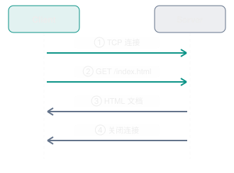
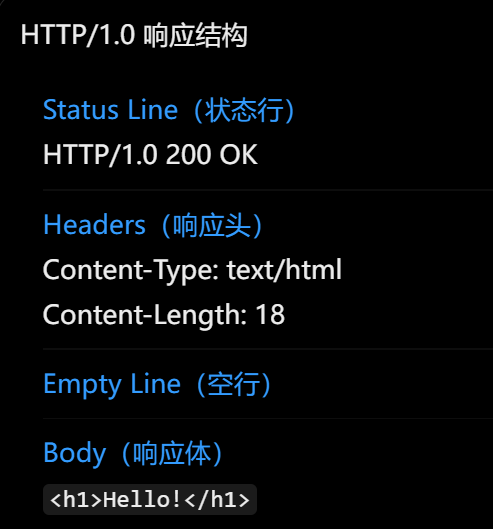
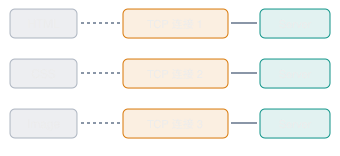

# HTTP
- 只有搞懂 HTTP 你才可以逐步明白 Nginx/URI/URL/HTTP Cache/HTTP/HTTPS/HTTP2 ~ HTTP3 之间的不同与区别
- 在开发时用到的 HTTP 尤为简单 但是底层运行机制和工作原理 并没有理解, 你可能遇到很多问题如下
  - Nginx 为何这样配置
  - HTTP 缓存 如何做的
  - HTTP/HTTPS 区别
  - SSL/TSL/SNI/OCSP/ALPN 是什么 等各种名称问题
- 由于 HTTP 涉及范围较广我们文章就通过 慢慢延展方式, 最后将其串联, 让你更加简单了解是什么样子的关系与如何运行

**首先我们先来讲讲浏览器请求流程: 浏览器 发送请求后 先向 DNS域名服务器请求 进行域名查询 获取 域名的 IP 地址, 浏览器获取 IP 后发送请求给 WebServer, 将结果返回给 浏览器渲染**

**纸上得来终觉浅, 绝知此事要躬行**
**时势造英雄, 英雄亦造时势**


## HTTP/HyperText Transfer Protocol(超文本传输协议)
HTTP 是一个通信协议标准, 属于应用层的协议

### 历史发展
HTTP 在现代生活中非常常见 你只要打开 手机/平板/电脑 你主要做的动作就是 上网(不管是 视频/音乐/游戏/咨询 这些都属于上网范畴), 全球所有需要通过 网络连接的应用 都需要依靠 HTTP 这个协议来运转

#### 网络互联 早期:
20世纪六十年代, 美国国防部建立 ARPANET(阿帕网), 七十年代TCP/IP协议出现, **它拥有分层结构 以及 如何 寻址,传输,路由,接收 进行标准化** 所以这也是替代 ARPANET 网的前提同时 TCP/IP 也奠定了未来互联网的基石

#### WWW 最初构想提出时期
1989年 任职于 欧洲核子研究中心的(CERN) 的 蒂姆·伯纳斯-李(Time Berners-Lee) 发表一篇论文 [万维网（World Wide Web，WWW）最初构想文档](https://www.w3.org/History/1989/proposal.html?utm_source=chatgpt.com), 其中在 论文中确立了这几个技术
- URI/URL: 解决如何表示和定位资源问题
- HTTP: 解决 Client/Server 如何交换资源表示问题
- HTML: 解决 展示超文本文档问题
**其中论文核心思想就是: 文档,研究数据,项目资料分散在不同激计算机系统 难以检索和维护, 依照论文解决思路 让信息通过超文本连接关联 无需放在一台计算机中**

#### HTTP/0.9 第一个版本
通常 0.9 被认为是 Simple HTTP 第一个版本, 受当时时代限制 当时网络上的信息, 所以 HTTP/0.9 只允许 `GET` 操作, 只允许简单的只读操作, 也就是说 **响应体(Response Body) 就是 HTML 文档** **没有 协议版本字段, 请求头, 请求体,响应头,状态码,持久连接,Cookie 等** 而 Client 和 Server 通信流程也极其简单



下面就是发送请求后响应的内容, 直接为 纯文本 没有 Host/User-Agent 等等
```shell
# request
GET xxx/index.html

# response
<html>
  <body>
    <h1>Hello World</h1>
  </body>
</html>
```

**这里我们可以看到 HTTP/0.9版本的问题**
- 无法通过状态码得知是否请求成功(status)
- 缺少内容类型描述(Content-Type)
- 缺少请求和响应元数据(就是 缺少 请求头和响应头)
- 每次获取文档就要建立新连接(获取一个资源就要开启一个 TCP 连接, 结束后关闭 页面增多开销也会增加)

#### HTTP/1.0
1993 年 开发出 Mosaic 浏览器, 第一个可以展示图片的浏览器, 在 1995 年 Apache 出现 简化了 HTTP 服务器搭建, 在着几年中出现了非常多新兴技术比如(1992 年 JPEG, 1995年 MP3 音乐格式)同时由于技术和娱乐性咨询增加 开始使用互联网的网民也越来越多

当一个技术使用的非常多时它发展的往往非常迅速, 在1996年 HTTP/1.0 版本正式发布 和我们现在使用的 HTTP/1.1 差距并不大
| 比较项        | HTTP/0.9  | HTTP/1.0                   |
| ------------- | --------- | -------------------------- |
| 请求方法      | GET       | GET/HEAD/POST              |
| 协议版本      | 不声明    | 显示声明                   |
| 请求头\响应头 | 无        | 有(让HTTP可以携带必要信息) |
| 状态码        | 无        | 有(标记可能错误的原因)     |
| 多媒体        | HTML 文档 | 支持不同MIME类型           |
| 缓存控制      | 无        | 支持基本缓存头             |
| 连接          | 每次关闭  | 默认非持久连接             |

下面是 HTTP 请求和响应的内容
```shell
# reuqest
# 扩展请求方法
GET xxx/index.html HTTP/1.0

# response
HTTP/1.0 200 OK # 增加状态码和版本号
# 增加 Header
Content-Type: text/html
Content-Length: 18

<h1>Hello!</h1>
```



#### HTTP/1.1 支持 多类型缓存问题
在 HTTP/1.1 时代互联网需求呈爆发时增加, 淘宝/Twitter/Facebook 等平台涌入, 但是这也可以发现 HTTP/1.1 的缺陷就是 连接慢, 但是还是有解决方案的 就是 压缩/合并 操作步骤 将 HTTP 请求在 小且少 的 天枰之间平衡

而 HTTP/1.0 的瓶颈我们在上面也有提到过就是 每次获取资源都需新建 TCP 连接(比如我们3个资源就要建立3次, 这时就会射击 连接状态维护与慢启动等问题)


**虽然只是一个小版本的更新, 区别就是 一个是 正式标准, 这意味着未来互联网上所有浏览器,服务器,网关,代理 只要用到 HTTP 就必须严格遵守该标准, 该版本解决一个问题就是 通过连接复用改善网络性能**

1. 解决的问题:
- KeepAlive: 客户端请求多个资源时可复用已有TCP连接, 连接不会在每次响应结束后自动关闭, 这减少了 TCP 五首和 连接创建以及慢启动开销
- 同步问题: HTTP1.1 引入 Pipelining(管线化) 客户端可以连续发送多个请求 而非 等待每个请求响应到达后才发送下一个, 但是还是要求 按序返回
- 响应体长度: HTTP1.1 引入 `Transfer-Encoding: chunked` 支持分块传输编码, 服务器发送内容前可以不必先计算整个响应体长度 这对 当前 AI 时候 流式响应非常重要
- Host 请求头: 解决统一IP地址区分不同网站
- 缓存控制: 万三资源有效应和验证缓存机制
- Range 请求: 支持获取文件指定字节范围 便于 断点续传和按需读取
- 内容协商: 支持 Client和Server 根据 语言编码媒体类型选择合适内容


2. 遗留问题
- 同一TCP不能像HTTP/2交错传输多个响应
- 流水线可能发生对头阻塞
- 并发请求通常需要多个 TCP 连接
- 头部字段重复发生产生额外开销

#### HTTP/2 连接复用升级为多路复用
HTTP/2 产生于Google 早期研发的 SPDY 协议有密切关系, 这时候的业务需求不在是简单的 HTML 文档而是 HTML/CSS/JS/Fonts/Image 和 大量 API 数据, 即使使用 HTTP/1.1 还是可能会因为请求排队和连接数量收到影响

HTTP2主要解决的问题: 带宽, 移动, 安全性, 性能
- 多路复用Multiplexing: 引入流(Stream) 和Frame(帧) 一条 TCP 连接可以建立多个 Stream, 每个 Stream 承载独立 HTTP 消息数据又分为多个 Frame 进行传输, 如下 请求可以并发进行 响应数据可以交错, 即使一个请求效率低其他流也有机会继续传输
```
TCP Connection
│
├── Stream 1：GET /index.html
├── Stream 3：GET /style.css
├── Stream 5：GET /app.js
└── Stream 7：GET /logo.png
```
- 二进制分帧 Binary Framing: 将消息编码为 二进制帧, 作用就是 明确识别帧边界, 归属流, 实现流级控制
```
HEADERS 传输压缩后的 HTTP 字段
DATA 传输请求体或响应体
SETTINGS 交换连接配置
WINDOW_UPDATE 更新流量控制窗口
```
- HPACK 头部压缩: 
- https://chatgpt.com/c/6af7eec8-0bb8-83ec-b592-3067815c5cca
- https://uaxe.github.io/geektime-docs/%E8%AE%A1%E7%AE%97%E6%9C%BA%E5%9F%BA%E7%A1%80/%E9%80%8F%E8%A7%86HTTP%E5%8D%8F%E8%AE%AE/01%20-%20%E6%97%B6%E5%8A%BF%E4%B8%8E%E8%8B%B1%E9%9B%84%EF%BC%9AHTTP%E7%9A%84%E5%89%8D%E4%B8%96%E4%BB%8A%E7%94%9F/#http3
- https://xiaolincoding.com/network/1_base/tcp_ip_model.html#%E5%BA%94%E7%94%A8%E5%B1%82

## DNS/Domain(域名解析服务)

## TCP 和 HTTP

## HTTP 数据传输过程


## 常用 状态码

## URI/Uniform Resourcae Identifiers(统一资源标识符)


## Reference
1. [HTTP Wiki](https://zh.wikipedia.org/wiki/%E8%B6%85%E6%96%87%E6%9C%AC%E4%BC%A0%E8%BE%93%E5%8D%8F%E8%AE%AE)